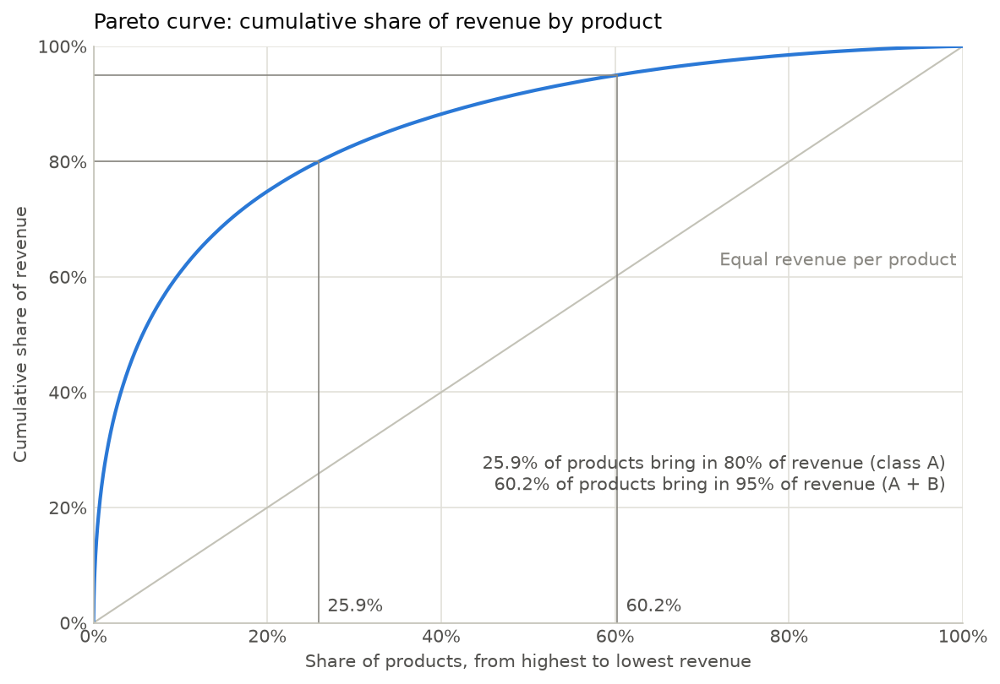
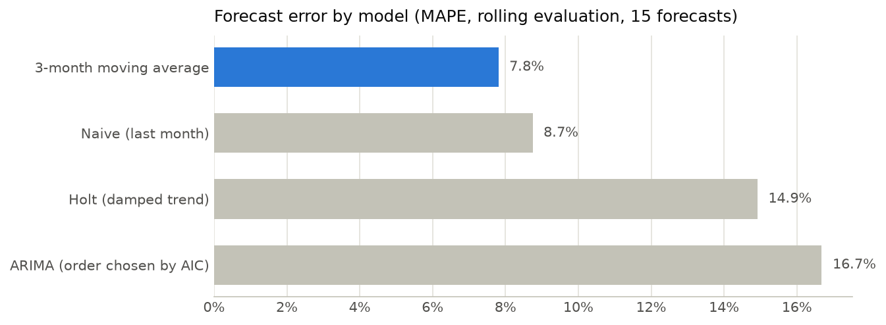
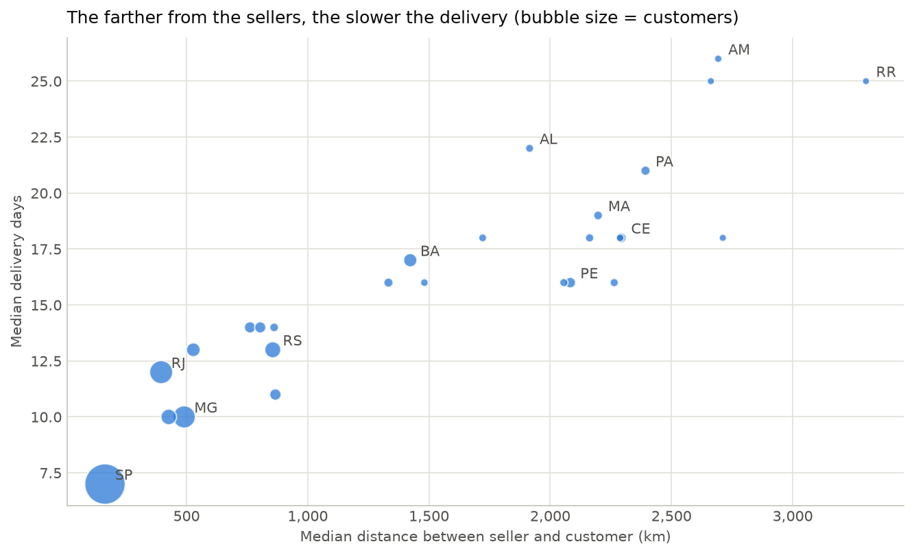
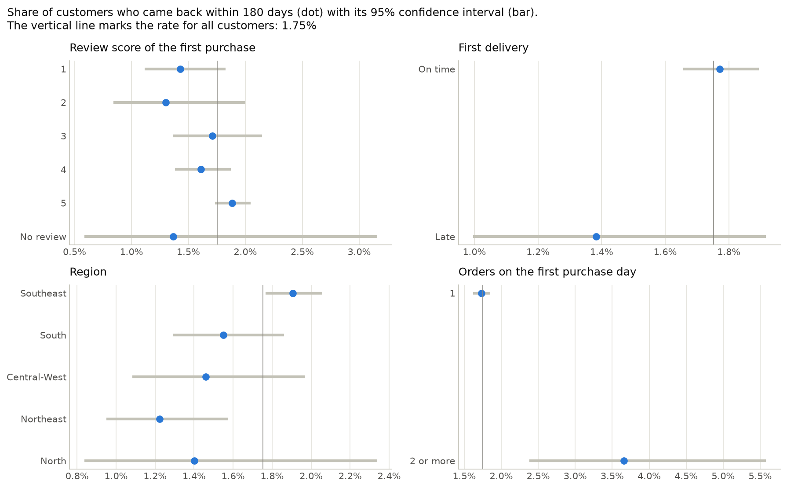

# E-Commerce Sales, Demand Forecasting & Customer Churn Analysis

Which products drive revenue, how much will sell in the coming months, where customers come from and where a new branch should open, and why most customers never come back. The four questions are answered with real e-commerce data (Olist, Brazil, 2016–2018), and every notebook is built to be rerun with the sales data of an agricultural machinery business.

**Stack:** SQL (SQLite) · Python (pandas, statsmodels, scikit-learn, SHAP) · Jupyter · Power BI

## The business problem

An agricultural machinery business needs to decide which items to push or reduce, how much stock to keep, where to open a new branch and how to keep its customers. Its sales system cannot export data without a more expensive plan, so the analysis is developed on a public dataset with the same structure (products, sale dates, customers and locations) and documented so it can be repeated with the business's own data.

## Business questions and short answers

| # | Business question | Short answer | Notebook |
|---|---|---|---|
| 1 | Which products and categories sell the most and the least? | 25.9% of the products bring in 80% of revenue, while 6,707 slow movers (20.9% of the catalog) bring in 2.6%. | [03_products](notebooks/03_products.ipynb) |
| 2 | How much will sell in the next 3 months, and how much inventory is needed? | About 7,260 units per month. A 3-month moving average (7.8% error) beat Holt and ARIMA, and each category gets its own safety stock. | [04_forecast_inventory](notebooks/04_forecast_inventory.ipynb) |
| 3 | Where do customers come from, and where should a new branch open? | 41.9% of customers are in the state of São Paulo. Bahia is the most robust candidate, and Salvador the best-supported city. | [05_geographic](notebooks/05_geographic.ipynb) |
| 4 | Why do some customers not come back, and who is about to leave? | Churn is 98.25%. The first purchase predicts little (ROC AUC 0.571), but returning is associated with location, everyday categories and the delivery experience. | [06_customer_churn](notebooks/06_customer_churn.ipynb) |

Each question closes with the same structure: **Business question → Analysis → Evidence → Insight → Recommendation → Application to the machinery business**, followed by its limitations. The last step matters because Olist is a proxy: every recommendation is translated into what it means for a business that sells tractors, implements and spare parts.

## Key findings

**Revenue is concentrated in a quarter of the products.** 5.6% of the products bring in half of the revenue and 25.9% bring in 80%. More than half of the catalog (55.0%) sold a single unit in 20 months.



**Simple forecasts beat complex ones.** Sales grew fast in 2017 and leveled off in 2018, so trend models kept projecting growth that no longer existed. The 3-month moving average had the lowest error in a rolling evaluation with 15 forecasts.



**Distance drives delivery time.** Across states, the rank correlation between distance to the sellers and delivery days is 0.89: 7 days in São Paulo, 17 in Bahia and 25 or more in the far North. Bahia combines a meaningful market with a large service gap, and it stays near the top of the branch ranking under every weighting tested.



**Almost nobody comes back.** Only 1.75% of customers made a second purchase within 180 days. Customers in the Southeast, customers who placed several orders on their first day and customers who bought everyday products came back more often, while holiday and gift buyers came back less.



## Data and cleaning

The **Brazilian E-Commerce Public Dataset by Olist** (CC BY-NC-SA 4.0) has about 100,000 orders in 9 CSV files. The files are not stored in the repository: [data/README.md](data/README.md) explains how to download them.

Cleaning ([01_data_cleaning](notebooks/01_data_cleaning.ipynb)) keeps the 96,470 delivered orders with a delivery date and handles four traps that silently inflate numbers when tables are joined: a new `customer_id` for every order, multiple payments per order, repeated reviews and a geolocation table with many rows per zip code. Every join is validated, and every removed row is recorded in a cleaning log.

**Data coverage:** 2016 has only 267 delivered orders, and from August 22, 2018 the data is incomplete in every order status. The analysis uses January 2017 to August 2018, with 19 complete months for forecasting.

## Methodology

**SQL → Python → models → Power BI.** The first notebook cleans the raw files with pandas and loads the clean tables into a SQLite database. From then on, aggregations are written in SQL and kept in [`sql/`](sql/), one query per file: rankings and cumulative shares with window functions, medians computed with `ROW_NUMBER`, a calendar built with a recursive CTE and the churn dataset built with `ROW_NUMBER` over purchase occasions. Python takes over for statistics, charts and models, and the results are saved as CSV files for the Power BI dashboard.

| Phase | Notebook | What it does |
|---|---|---|
| 1 | [01_data_cleaning](notebooks/01_data_cleaning.ipynb) | Joins and cleans the tables, creates revenue, delivery time and delay, builds the SQLite database |
| 2 | [02_exploratory_analysis](notebooks/02_exploratory_analysis.ipynb) | Sales by month, weekday and hour; seasons; ticket; categories; regions |
| 3 | [03_products](notebooks/03_products.ipynb) | Rankings, Pareto analysis, ABC classification, slow movers, category trends |
| 4 | [04_forecast_inventory](notebooks/04_forecast_inventory.ipynb) | Baselines against Holt and ARIMA, 3-month forecast, safety stock by category |
| 5 | [05_geographic](notebooks/05_geographic.ipynb) | Customer map, service gap by state, branch ranking with sensitivity analysis |
| 6 | [06_customer_churn](notebooks/06_customer_churn.ipynb) | Churn definition, leakage checks, return rates with confidence intervals, two models, SHAP |
| 7 | — | Power BI dashboard, final report and application guide |

## Analytical decisions evaluated

- **The end of the data is not a drop in sales.** Orders fell sharply in late August 2018 in every status, so August 2018 is treated as incomplete instead of being fed to the models.
- **Same-day orders are one purchase.** 786 customers placed several orders on a single day; counting them as returning customers would have inflated the repeat rate.
- **No seasonal forecasting models.** Holt-Winters and SARIMA need two full years to estimate a yearly pattern, and there are 19 months. The fit fails, and the notebook shows it.
- **No hand-picked ARIMA.** Its order is chosen by AIC inside each training window, because choosing it after seeing the test results would overstate its accuracy.
- **No RFM segmentation.** 97.8% of customers bought on a single day, so frequency separates nobody.
- **Branch criteria fixed before the results.** The weights (50% demand, 50% service gap) were defined first and then tested with 70/30 and 30/70.
- **Confidence intervals on every group comparison.** With a 1.75% return rate, several differences that look meaningful (review score, late deliveries) turn out to be inconclusive.

## Models and how they were compared

**Forecast.** Four models were compared on total monthly units with a holdout (May to July 2018) and a rolling evaluation (15 forecasts), choosing the lowest rolling MAPE, a rule set before looking at the results:

| Model | Rolling MAPE | Holdout MAPE |
|---|---|---|
| 3-month moving average | 7.8% | 7.8% |
| Naive (last month) | 8.7% | 8.1% |
| Holt (damped trend) | 14.9% | 28.6% |
| ARIMA (order chosen by AIC) | 16.7% | 10.5% |

**Churn.** A logistic regression and a random forest were trained on customers whose first purchase was before October 2017 and tested on later customers:

| Model | ROC AUC | Returning customers found in the top 10% |
|---|---|---|
| Random forest | 0.571 | 15.0% |
| Logistic regression | 0.558 | 13.7% |

A random ranking would score 0.5 and find 10%. Both models are weak, which is a finding in itself: the first purchase says little about whether a customer will come back.

## Limitations

- **Olist is a proxy.** It is a Brazilian marketplace where sellers ship from their own locations and hold their own stock, not an agricultural machinery business. Inventory and branch results illustrate the method rather than an actual plan.
- **Short history.** 19 complete months, without a full yearly cycle, limit the forecast and any conclusion about seasons.
- **The churn definition shapes the results.** The 180-day window and the prediction moment are documented choices, and the model has only 875 returning customers to learn from.
- **Correlation is not causation.** Group comparisons and SHAP values show associations with coming back, not causes; only experiments can prove causes.
- **Missing information.** There are no product names, costs, margins, marketing contacts, competitor prices or customer demographics, and distances are straight lines between zip code areas.

## Implications for the machinery business

- Classify items with ABC, on margin as well as revenue, and apply order-on-demand to expensive items with intermittent demand such as tractors.
- Plan spare parts with a simple forecast recalculated every month, and size the safety stock with the real supplier lead times.
- Agree on the branch criteria and their weights before looking at the ranking, and add opening costs to the decision.
- Measure churn on spare parts and service with a 6 to 12 month window, where repeat purchases are far more common than in Olist.

The [application guide](docs/application_guide.md) explains which columns the business export needs and how to adapt each phase.

## Dashboard

*In progress.* A Power BI dashboard with one page per business question (**Products**, **Inventory**, **Locations** and **Customers**) built from the CSV files in `data/processed/`, following the [dashboard build guide](docs/dashboard_guide.md).

## Repository structure

```text
├── data/
│   ├── README.md       # How to download the dataset and regenerate every file
│   ├── raw/            # Original Olist CSV files (not versioned)
│   └── processed/      # Outputs of each notebook and the SQLite database (not versioned)
├── notebooks/          # One notebook per phase (01 to 06)
├── sql/                # SQL queries used by the notebooks
├── reports/
│   └── figures/        # Charts exported by the notebooks
├── dashboard/          # Power BI file and screenshots
├── docs/               # Application guide and dashboard build guide
├── requirements.txt    # Python dependencies
└── README.md
```

## How to reproduce

1. Install **Python 3.12** from [python.org](https://www.python.org/downloads/).
2. Create a virtual environment and install the dependencies:

   ```bash
   python -m venv .venv
   .venv\Scripts\Activate.ps1        # Windows (PowerShell)
   source .venv/bin/activate         # macOS / Linux
   pip install -r requirements.txt
   ```

3. Download the dataset into `data/raw/` following [data/README.md](data/README.md).
4. Run the notebooks in order, from 01 to 06, in Jupyter or from the terminal:

   ```bash
   jupyter nbconvert --to notebook --execute --inplace notebooks/01_data_cleaning.ipynb
   ```

## What I learned

- **Validating every join.** Four traps in this dataset would have inflated revenue or the number of returning customers without raising any error. Checking joins with `validate` and logging every cleaning step made them visible.
- **Looking at the edges of the data before modeling.** What looked like a sales drop at the end of August 2018 was the end of the data.
- **Letting evidence choose the model.** Simple baselines and a decision rule set in advance showed that more complex models were not better here.
- **Designing a target without leakage.** Defining churn required a prediction moment, a window and a check that every feature was known at that moment.
- **Reporting uncertainty and weak results honestly.** Confidence intervals, forecast ranges and a weak churn model are part of the answer, not something to hide.
- **Combining SQL and Python.** Window functions, recursive CTEs and views for the aggregations; Python for statistics, charts and models.
- **Turning analysis into decisions.** Every question ends in a recommendation with its limits, and in what it means for the business the project was built for.

## Tools

Python · pandas · NumPy · matplotlib · seaborn · statsmodels · scikit-learn · SHAP · SQL (SQLite) · Jupyter · Power BI · Git and GitHub
